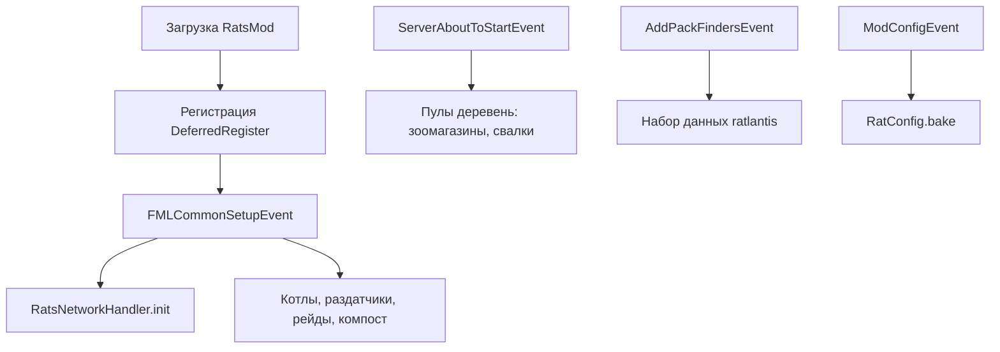

# Архитектура кода

## Точка входа

Класс `RatsMod` (`com.github.alexthe666.rats.RatsMod`) — единственный класс с аннотацией `@Mod("rats")`.

При запуске выполняется:

1. Регистрация конфигурации клиента и сервера (`ConfigHolder`).
2. Включение жидкого молока (`ForgeMod.enableMilkFluid()`).
3. Регистрация всех `DeferredRegister` на шине мода.
4. Подписка на `FMLCommonSetupEvent` — отложенная инициализация механик.
5. Подписка на `ServerAboutToStartEvent` — вставка структур в пулы деревень.
6. Подписка на `AddPackFindersEvent` — регистрация набора данных Ратлантис.

```64:127:Rats-1.20/src/main/java/com/github/alexthe666/rats/RatsMod.java
@Mod(RatsMod.MODID)
public class RatsMod {
	// ...
	public RatsMod() {
		// регистрация реестров, capability, setup, pet shops, ratlantis pack
	}
}
```

## Дерево пакетов (644 файла Java)

| Пакет | Файлов | Назначение |
|-------|--------|------------|
| `server/` | ~380 | Игровая логика: сущности, блоки, предметы, рецепты, мир |
| `client/` | ~172 | Рендер, модели, интерфейс, частицы |
| `registry/` | ~36 | Регистрация контента Forge |
| `data/` | ~41 | Генерация данных (рецепты, теги, добыча) |
| `compat/` | ~9 | JEI и прочее |
| `mixin/` | 2 | Патчи поведения ванильных мобов |
| корень | 4 | `RatsMod`, `RatConfig`, `ConfigHolder`, `package-info` |

### Сервер — важные подпакеты

| Подпакет | Назначение |
|----------|------------|
| `server/entity/rat/` | Иерархия крысы (5 классов) |
| `server/entity/ai/goal/` | Цели ИИ (~32 + 15 harvest) |
| `server/entity/ai/navigation/` | Патфайндинг, трубы, полёт |
| `server/items/upgrades/` | ~72 класса улучшений |
| `server/block/entity/` | Логика машин |
| `server/message/` | Сетевые пакеты |
| `server/events/` | Обработчики Forge-событий |
| `server/world/` | Ратлантис, чумной доктор, генерация |
| `server/recipes/` | Кастомные типы рецептов |
| `server/capability/` | Выбранная крыса игрока |

### Клиент

| Подпакет | Назначение |
|----------|------------|
| `client/render/` | Рендереры сущностей и блоков |
| `client/model/` | Модели (крысы, шляпы, боссы) |
| `client/gui/` | Экраны крысы, улучшений, фильтров |
| `client/events/` | Клиентские подписчики |

## Реестры (`registry/`)

Все реестры используют `DeferredRegister` NeoForge/Forge.

| Класс | Содержимое |
|-------|------------|
| `RatsEntityRegistry` | Крысы, боссы, снаряды, ездовые |
| `RatsBlockRegistry` | Блоки основного мода |
| `RatsItemRegistry` | Предметы и улучшения |
| `RatsBlockEntityRegistry` | Сущности блоков |
| `RatsMenuRegistry` | Меню интерфейсов |
| `RatsSoundRegistry` | Звуки |
| `RatsEffectRegistry` | Эффекты (чума, конфи) |
| `RatsRecipeRegistry` | Типы рецептов |
| `RatsVillagerRegistry` | Профессия «зоомагазин» |
| `RatVariantRegistry` | Варианты окраски крыс |
| `RatsUpgradeConflictRegistry` | Несовместимые улучшения |
| `Ratlantis*Registry` | Контент измерения |
| `worldgen/Ratlantis*` | Биомы, структуры, черты |

## Конфигурация

| Класс | Роль |
|-------|------|
| `ConfigHolder` | Спецификации Forge Config |
| `ServerConfig` | Определения полей сервера |
| `ClientConfig` | Определения полей клиента |
| `RatConfig` | Статические значения после `bakeServer()` / `bakeClient()` |

## Генерация данных

Запуск: `./gradlew runData` (задача `data` в `build.gradle`).

Выход: `src/generated/resources/` — рецепты, теги, достижения, модификаторы биомов.

Классы-генераторы в `data/`: `RatsRecipes`, `RatsUpgradeRecipes`, `RatlantisRecipes`, теги, лут.

## Сборка

- **Gradle** + плагин `net.neoforged.gradle` 6.x
- **Mixin** `rats.mixins.json` + `citadel.mixins.json`
- **Access Transformer** `accesstransformer.cfg`
- Компиляция с `-Werror` (предупреждения = ошибка)

## Правила игры (GameRules)

Зарегистрированы в `RatsMod`:

- `doRatSpawning`
- `doPiperSpawning`
- `doPlagueDoctorSpawning`

## Внешний код, встроенный автором

| Источник | Где используется |
|----------|------------------|
| [Gist TelepathicGrunt](https://gist.github.com/TelepathicGrunt/4fdbc445ebcbcbeb43ac748f4b18f342) | Вставка домов в пулы деревень (`addPetShops`) |
| Immersive Engineering (по комментарию) | `RatsStructureUpdater` — обновление структур |
| Citadel | Анимации всех `IAnimatedEntity` |

## Поток жизненного цикла мода



## Capability

`SelectedRatCapability` — хранит UUID крысы, выбранной посохом/интерфейсом, на игроке.

Подключение: `RatsCapabilityRegistry.attachCap` на всех `Entity`.
